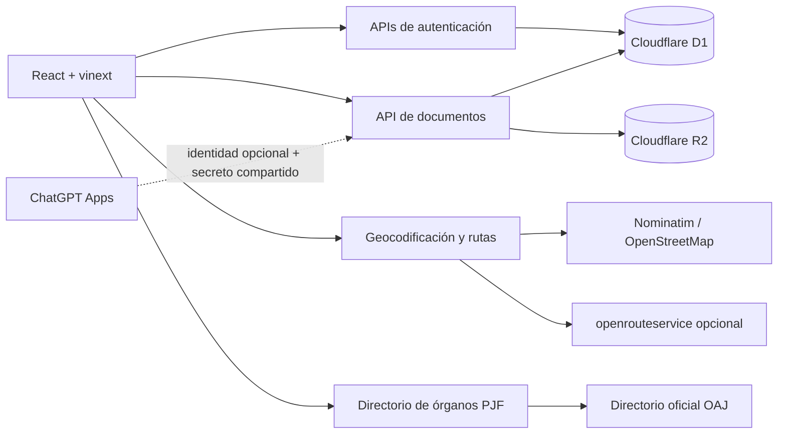

<div align="center">
  

# AppTuario

**Gestión de notificaciones y diligencias para actuarías judiciales mexicanas.**

Prototipo orientado inicialmente a notificaciones en juicios de amparo.

</div>

## Descripción

AppTuario ayuda a organizar la jornada de personas actuarias judiciales: concentra documentos, adscripción, domicilios, rutas, calendario, evidencia de campo y borradores relacionados con las diligencias.

La aplicación combina una interfaz React adaptable con APIs ejecutadas sobre Cloudflare Workers, almacenamiento estructurado en D1 y archivos privados en R2. El proyecto se encuentra en desarrollo y no sustituye sistemas oficiales, el criterio profesional, la fe pública ni la revisión jurídica de cada actuación.

## Estado funcional

| Módulo                                          | Estado actual                                                                                           |
| ----------------------------------------------- | ------------------------------------------------------------------------------------------------------- |
| Registro e inicio de sesión                     | Implementado con usuario, correo, contraseña protegida, sesiones y aceptación legal versionada          |
| Adscripción                                     | Directorio dinámico de órganos del PJF por circuito y órganos nacionales                                |
| Documentos                                      | Carga privada de Word, PDF, imágenes y audio; metadatos en D1 y archivos en R2                          |
| Mapas                                           | MapLibre + OpenFreeMap, búsqueda de domicilios y mapa sobre Guadalajara                                 |
| Rutas                                           | Optimización con openrouteservice cuando existe llave; aproximación local como respaldo                 |
| Aviso de Privacidad y Términos                  | Páginas integradas y documentos extensos en `docs/legal/`                                               |
| Docker                                          | Imagen multi-stage, persistencia local y migraciones automáticas                                        |
| Integración con ChatGPT Apps                    | Empaquetado con OpenAI Sites; identidad inyectada exige `CHATGPT_CONNECTOR_SECRET` (fail closed sin él) |
| Notificaciones, evidencia, calendario y razones | Interfaz de prototipo; falta completar persistencia y flujo procesal de extremo a extremo               |

> [!IMPORTANT]
> Hasta completar la revisión jurídica, el contrato de encargo, la evaluación de impacto y los controles institucionales, utiliza exclusivamente datos ficticios o anonimizados.

## Arquitectura



### Tecnologías principales

- React 19, TypeScript y vinext.
- Vite y Tailwind CSS.
- Cloudflare Workers, D1 y R2.
- Drizzle ORM y migraciones SQLite.
- MapLibre GL JS, OpenFreeMap, OpenStreetMap/Nominatim y openrouteservice.
- Docker y Docker Compose.
- `@openai/sites-vite-plugin`, para empaquetar AppTuario como app embebida en ChatGPT (OpenAI Sites).

### Integración con ChatGPT Apps

AppTuario también se puede desplegar como una app embebida en ChatGPT mediante OpenAI Sites (ver `.openai/hosting.json`, la dependencia `@openai/sites-vite-plugin` y el dominio `apptuario.sickboooooy.chatgpt.site`). En ese modo, ChatGPT puede propagar la identidad de quien conversa mediante los headers `oai-authenticated-user-*`.

Como el mismo Worker también es alcanzable directamente (URL pública de Cloudflare, contenedor Docker) y nada garantiza que esos headers lleguen únicamente a través del gateway de OpenAI, `app/chatgpt-auth.ts` **nunca** los confía por sí solos: exige además el header `x-apptuario-connector-secret` con un valor que coincida con la variable de entorno `CHATGPT_CONNECTOR_SECRET`. Sin ese secreto configurado, la identidad inyectada por ChatGPT queda deshabilitada por defecto y solo funciona el login normal por sesión.

## Inicio rápido local

### Requisitos

- Node.js 22.13 o posterior.
- npm.

### Instalación

```powershell
git clone https://github.com/Sickboooooy/apptuario.git
cd apptuario
npm ci
npm run db:migrate:local
npm run dev
```

Abre <http://localhost:3000>.

El comando de migración compila la aplicación, prepara las migraciones para Wrangler y crea o actualiza la base D1 local en `.wrangler/state`.

### Rutas viales opcionales

La aplicación funciona sin credenciales externas. En ese modo utiliza Nominatim para geocodificar y un cálculo aproximado local para ordenar destinos.

Para habilitar calles, distancias y tiempos viales con openrouteservice:

```powershell
Copy-Item .dev.vars.example .dev.vars
```

Después agrega la llave al archivo ignorado por Git:

```dotenv
ORS_API_KEY=tu_llave
```

Nunca uses el prefijo `NEXT_PUBLIC_` para esta llave: debe permanecer en el servidor.

## Ejecución con Docker

Requiere Docker Desktop con Compose v2.

```powershell
docker compose up --build -d
```

Abre <http://localhost:3001>. El contenedor aplica las migraciones pendientes al iniciar y conserva D1/R2 en el volumen `apptuario_data`.

Comandos habituales:

```powershell
docker compose ps
docker compose logs -f apptuario
docker compose down
```

Consulta la [guía completa de Docker](docs/docker.md) para configurar otro puerto, habilitar `ORS_API_KEY` o eliminar el volumen local.

## Comandos del proyecto

| Comando                    | Función                                          |
| -------------------------- | ------------------------------------------------ |
| `npm run dev`              | Inicia el servidor de desarrollo                 |
| `npm run build`            | Genera la compilación de producción              |
| `npm start`                | Ejecuta la compilación con Wrangler              |
| `npm run lint`             | Ejecuta Oxlint                                   |
| `npm run format`           | Aplica Oxfmt                                     |
| `npm run db:generate`      | Genera migraciones desde el esquema Drizzle      |
| `npm run db:migrate:local` | Compila y aplica migraciones a D1 local          |

## Variables de entorno

| Variable                   | Requerida | Descripción                                                                                                                                |
| -------------------------- | --------- | ------------------------------------------------------------------------------------------------------------------------------------------ |
| `ORS_API_KEY`              | No        | Habilita geocodificación, optimización y direcciones viales mediante openrouteservice                                                      |
| `CHATGPT_CONNECTOR_SECRET` | No        | Habilita la identidad inyectada por ChatGPT Apps (`oai-authenticated-user-*`) en /api/documents; sin ella, ese fallback está deshabilitado |
| `APPTUARIO_PORT`           | No        | Puerto del host para Docker; predeterminado `3001`                                                                                         |
| `APPTUARIO_VARS_FILE`      | No        | Archivo de variables montado en el contenedor; predeterminado `.dev.vars.example`                                                          |

Los enlaces locales de Cloudflare se configuran como `DB` para D1 y `FILES` para R2 mediante `.openai/hosting.json`.

## API disponible

| Método y ruta                       | Descripción                                    |
| ----------------------------------- | ---------------------------------------------- |
| `POST /api/auth/register`           | Registra una cuenta y crea la sesión           |
| `POST /api/auth/login`              | Inicia sesión con usuario o correo             |
| `GET /api/auth/session`             | Devuelve la sesión local actual                |
| `DELETE /api/auth/session`          | Cierra la sesión                               |
| `GET /api/federal-courts`           | Devuelve circuitos disponibles                 |
| `GET /api/federal-courts?circuit=3` | Consulta órganos del circuito indicado         |
| `GET /api/documents`                | Lista documentos del usuario autenticado       |
| `POST /api/documents`               | Guarda un archivo privado de hasta 25 MB       |
| `POST /api/geocode`                 | Busca un domicilio con contexto de Guadalajara |
| `POST /api/routes/optimize`         | Ordena destinos y genera la geometría de ruta  |

## Modelo de datos

El esquema principal se encuentra en `db/schema.ts` y contiene:

- `users` y `user_sessions`;
- `cases` y `documents`;
- `recipients` y `notifications`;
- `evidence` y `templates`; y
- `calendar_entries`.

Las migraciones versionadas se conservan en `drizzle/`.

## Estructura del repositorio

```text
app/                 páginas y endpoints HTTP
components/          interfaz, autenticación, mapa y planificador
db/                  esquema y acceso a Cloudflare D1
drizzle/             migraciones de base de datos
lib/                 autenticación, catálogo judicial, versiones legales y tipos de rutas
public/              identidad gráfica y recursos estáticos
docs/                Docker, mapas, PJF y documentación legal
```

## Privacidad y seguridad

- Las contraseñas se derivan con PBKDF2 y no se almacenan en texto legible.
- Las sesiones utilizan tokens aleatorios, hash del token y cookie `HttpOnly`.
- Los archivos se separan por propietario mediante una clave derivada y se almacenan en R2.
- La identidad inyectada por ChatGPT (`oai-authenticated-user-*`) nunca se confía sin el secreto compartido `CHATGPT_CONNECTOR_SECRET`; sin él, ese acceso queda deshabilitado por defecto (ver [Integración con ChatGPT Apps](#integración-con-chatgpt-apps)).
- El buscador de mapas sólo debe recibir el domicilio necesario: nunca nombres, expedientes o notas judiciales.
- Los documentos generados, rutas y calendarios son auxiliares sujetos a revisión humana.

Consulta:

- [Aviso de Privacidad](docs/legal/aviso-de-privacidad.md)
- [Términos y Condiciones](docs/legal/terminos-y-condiciones.md)
- [Checklist previo a publicación](docs/legal/checklist-publicacion.md)

Los documentos legales contienen campos pendientes entre corchetes y requieren revisión profesional antes de publicarse.

## Mapas y directorio judicial

- [Configuración y privacidad de mapas](docs/maps.md)
- [Catálogo de órganos del Poder Judicial de la Federación](docs/organos-pjf.md)

La información del directorio oficial se conserva temporalmente en memoria y puede cambiar cuando el OAJ actualice altas, cierres, denominaciones o residencias.

## Desarrollo y contribuciones

Antes de proponer cambios:

```powershell
npm run lint
npx tsc --noEmit
npm run build
```

No agregues `.dev.vars`, credenciales, expedientes reales, evidencias, bases locales ni archivos de `.wrangler/` al repositorio.

## Hoja de ruta

- Persistencia completa de notificaciones y resultados de diligencia.
- Captura segura de fotografía y notas de voz asociadas a una notificación.
- Calendario y seguimiento de citatorios, avisos y diligencias parciales.
- Plantillas configurables para citatorios, avisos, notificaciones personales y razones.
- Extracción asistida de acuerdos y sentencias con revisión humana.
- Exportación de razones actuariales y trazabilidad de cambios.
- Controles institucionales, auditoría y evaluación de impacto en protección de datos.

## Licencia

El repositorio todavía no incluye un archivo de licencia. Antes de distribuir o recibir contribuciones externas debe definirse expresamente el régimen aplicable.
